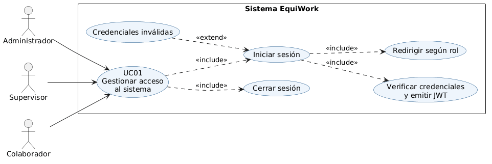

# UC01 — Gestionar acceso al sistema

| Campo | Contenido |
|-------|-----------|
| **Caso de Uso** | Gestionar acceso al sistema |
| **Versión** | V1 |
| **Referencia** | CU1 (UC01) |
| **Autor** | Mateo |
| **Fecha** | 24/10/2026 |
| **Actores** | Administrador, Supervisor, Colaborador |
| **Referencias** | RF01, RF02 |
| **Precondiciones** | Para iniciar sesión: cuenta registrada con estado activo. Para cerrar sesión: sesión autenticada válida. |
| **Postcondición** | Tras login: JWT en cookie httpOnly y redirección a `/dashboard` (staff) o `/encuesta` (colaborador). Tras logout: sesión finalizada y usuario en `/login`. |

**Flujo normal — Iniciar sesión**

| Paso | Actor | Descripción |
|------|-------|-------------|
| 1 | Usuario | Accede a `/login` e ingresa correo y contraseña. |
| 2 | Sistema | Verifica usuario activo y contraseña (bcrypt). |
| 3 | Sistema | Genera JWT y establece cookie httpOnly. |
| 4 | Usuario | Es redirigido al inicio según su rol. |

**Flujo normal — Cerrar sesión**

| Paso | Actor | Descripción |
|------|-------|-------------|
| 1 | Usuario | Selecciona cerrar sesión. |
| 2 | Sistema | Elimina cookie y destruye la sesión. |
| 3 | Usuario | Vuelve a la pantalla de login. |

**Flujos alternos:** Credenciales incorrectas → mensaje en login sin detallar cuál campo falló.

**Excepciones:** Servidor o base de datos no disponibles → error de conexión o página de error.
