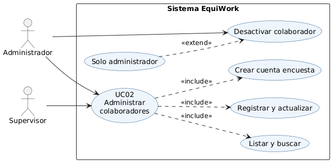

# UC02 — Administrar colaboradores

| Campo | Contenido |
|-------|-----------|
| **Caso de Uso** | Administrar colaboradores |
| **Versión** | V1 |
| **Referencia** | CU2 (UC02) |
| **Autor** | Mateo |
| **Fecha** | 24/10/2026 |
| **Actores** | Administrador, Supervisor |
| **Referencias** | RF04, RF05, RF06, RF07, RF08 |
| **Precondiciones** | Usuario autenticado con rol Administrador o Supervisor. |
| **Postcondición** | Maestro de colaboradores actualizado; opcionalmente cuenta de encuesta creada para colaborador activo. |

**Flujo normal**

| Paso | Actor | Descripción |
|------|-------|-------------|
| 1 | Usuario | Ingresa a `/colaboradores` y consulta o busca en el listado. |
| 2 | Usuario | Registra o edita datos del colaborador (identificación, contacto, estado). |
| 3 | Sistema | Valida campos, unicidad de correo y persiste en base de datos. |
| 4 | Usuario | Opcionalmente crea cuenta de encuesta con contraseña inicial para el colaborador. |
| 5 | Usuario | (Solo Administrador) Desactiva colaboradores que ya no pertenecen al equipo. |

**Flujos alternos:** Supervisor intenta desactivar colaborador → acceso denegado (403). Alta con cuenta encuesta en el mismo flujo de registro.

**Excepciones:** Colaborador inactivo al crear cuenta → error de negocio. Validación fallida → 400 con mensajes por campo.
