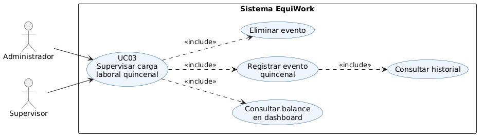

# UC03 — Supervisar carga laboral quincenal

| Campo | Contenido |
|-------|-----------|
| **Caso de Uso** | Supervisar carga laboral quincenal |
| **Versión** | V1 |
| **Referencia** | CU3 (UC03) |
| **Autor** | Mateo |
| **Fecha** | 24/10/2026 |
| **Actores** | Administrador, Supervisor |
| **Referencias** | RF03, RF09, RF10, RF11 |
| **Precondiciones** | Staff autenticado. Quincena y colaboradores configurados. |
| **Postcondición** | Balance visible en dashboard; eventos quincenales registrados, consultados o eliminados según la acción. |

**Flujo normal**

| Paso | Actor | Descripción |
|------|-------|-------------|
| 1 | Usuario | En `/dashboard` selecciona quincena y revisa balance (totales, gráficos, estado por colaborador). |
| 2 | Usuario | En `/eventos` selecciona colaborador y quincena; consulta historial de eventos. |
| 3 | Usuario | Registra nuevo evento (fecha, horas, tipo, descripción) o elimina uno existente tras confirmar. |
| 4 | Sistema | Valida colaborador activo, fechas dentro de la quincena y persiste cambios. |
| 5 | Usuario | Visualiza historial y totales actualizados. |

**Flujos alternos:** Quincena sin registros → listados vacíos o aviso informativo. Datos inválidos → mensajes de validación.

**Excepciones:** Colaborador inactivo al registrar evento → error de negocio. Sin autenticación → 401.
