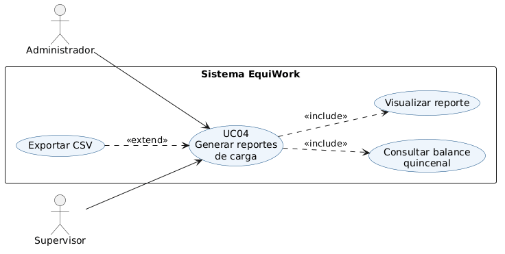

# UC04 — Generar reportes de carga

| Campo | Contenido |
|-------|-----------|
| **Caso de Uso** | Generar reportes de carga |
| **Versión** | V1 |
| **Referencia** | CU4 (UC04) |
| **Autor** | Mateo |
| **Fecha** | 24/10/2026 |
| **Actores** | Administrador, Supervisor |
| **Referencias** | RF12 |
| **Precondiciones** | Staff autenticado. Quincena seleccionada. |
| **Postcondición** | Reporte quincenal mostrado en pantalla; opcionalmente archivo CSV descargado. |

**Flujo normal**

| Paso | Actor | Descripción |
|------|-------|-------------|
| 1 | Usuario | Accede a `/reportes` y elige la quincena. |
| 2 | Sistema | Calcula balance de carga (misma lógica que dashboard) y arma el resumen. |
| 3 | Usuario | Revisa tablas y totales en pantalla. |
| 4 | Usuario | Opcionalmente solicita exportación CSV. |
| 5 | Sistema | Entrega archivo descargable con datos del reporte. |

**Flujos alternos:** Quincena sin datos → reporte vacío o mensaje informativo.

**Excepciones:** Error al generar o exportar → mensaje de error controlado.
