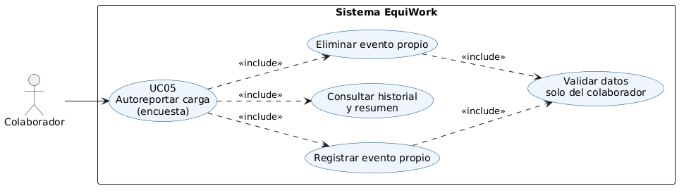

# UC05 — Autoreportar carga (encuesta)

| Campo | Contenido |
|-------|-----------|
| **Caso de Uso** | Autoreportar carga (encuesta) |
| **Versión** | V1 |
| **Referencia** | CU5 (UC05) |
| **Autor** | Mateo |
| **Fecha** | 24/10/2026 |
| **Actores** | Colaborador |
| **Referencias** | RF13, RF14, RF15 |
| **Precondiciones** | Colaborador autenticado con cuenta vinculada a su `colaborador_id`. |
| **Postcondición** | Eventos propios registrados, consultados o eliminados; resumen de horas actualizado. |

**Flujo normal**

| Paso | Actor | Descripción |
|------|-------|-------------|
| 1 | Usuario | Ingresa a `/encuesta` y selecciona quincena. |
| 2 | Sistema | Muestra historial y total de horas solo del colaborador autenticado. |
| 3 | Usuario | Registra un evento de carga con fecha, horas, tipo y descripción. |
| 4 | Sistema | Valida datos dentro de la quincena y persiste el evento. |
| 5 | Usuario | Puede eliminar un evento propio tras confirmación y ver el resumen actualizado. |

**Flujos alternos:** Formulario con errores → mensajes de validación en pantalla.

**Excepciones:** Sesión expirada → redirección a login. Intento sobre datos de otro colaborador → 403.
