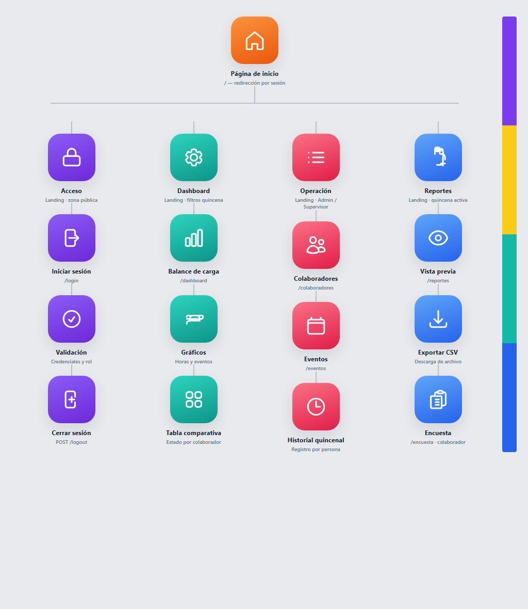

# Mapa de la estructura de información — EquiWork

Documento derivado del diseño de software (casos de uso UC01–UC15, actividades ACT01–ACT06 y rutas web del sistema). Describe **qué páginas existen**, **cómo se relacionan** y **qué ve cada tipo de usuario**.

## Mapa visual



Diseño jerárquico tipo árbol (inicio → pilares → páginas). Fuente editable: `mapa-sitio.html`.
Regenerar PNG: `powershell -File docs/export-mapa-sitio.ps1`

---

## Estructura jerárquica del sitio

```
EquiWork (aplicación web)
├── / ........................... Punto de entrada (redirección según sesión y rol)
├── /login ...................... Acceso al sistema (público)
│
├── [Staff: Administrador / Supervisor]
│   ├── /dashboard .............. Panel analítico de carga laboral
│   ├── /colaboradores .......... Maestro de colaboradores y cuentas encuesta
│   ├── /eventos ................ Registro quincenal de eventos (supervisión)
│   └── /reportes ............... Consulta y exportación de reportes
│
└── [Colaborador]
    └── /encuesta ............... Autoreporte de actividades quincenales

Acción transversal (autenticado): POST /logout → /login
```

Las pantallas autenticadas consumen datos vía **API REST** (`/api/...`); esas rutas no son páginas navegables, sino servicios que alimentan tablas, gráficos y formularios.

---

## Elementos de navegación principal

| Elemento | Ubicación | Función |
|----------|-----------|---------|
| **Marca EquiWork (EW)** | Parte superior del sidebar | Enlace al “inicio” del rol: `/dashboard` (staff) o `/encuesta` (colaborador). |
| **Detalle de usuario** | Sidebar, debajo de la marca | Muestra **nombre** y **rol** (ADMINISTRADOR, SUPERVISOR, COLABORADOR). No lleva a otra página; orienta al usuario sobre su contexto de acceso. |
| **Menú lateral (sidebar)** | Sidebar | Enlaces principales según rol (ver tabla siguiente). Resalta la sección activa. En móvil se abre con el ícono de menú (☰). |
| **Cerrar sesión** | Esquina superior derecha del área de contenido (escritorio); barra superior en móvil | Finaliza la sesión (cookie JWT y sesión servidor) y devuelve a `/login`. |

### Ítems del menú lateral por rol

| Ítem | Ruta | Roles |
|------|------|--------|
| Dashboard | `/dashboard` | Administrador, Supervisor |
| Colaboradores | `/colaboradores` | Administrador, Supervisor |
| Eventos | `/eventos` | Administrador, Supervisor |
| Reportes | `/reportes` | Administrador, Supervisor |
| Encuesta | `/encuesta` | Colaborador |

Un colaborador **no** accede a dashboard, colaboradores, eventos ni reportes (redirección a encuesta). El staff **no** usa la vista encuesta como flujo principal (redirección a dashboard si intenta entrar).

---

## Información que encuentra el usuario en cada sección

### `/login` — Iniciar sesión (UC01 / ACT01)

- Formulario de **correo** y **contraseña**.
- Mensajes de error si las credenciales fallan o la validación no pasa.
- Tras un login correcto, redirección automática según rol (dashboard o encuesta).
- Referencia a cuentas de demostración (documentación/pruebas).

### `/dashboard` — Dashboard analítico (UC03 / ACT04)

- **Selector de quincena** para acotar el análisis temporal.
- **Indicadores agregados**: meta de horas quincenales, promedio del equipo, totales.
- **Gráficos** (barras/dona) de horas y eventos por colaborador.
- **Tabla comparativa** con estado de carga por persona: equilibrado, sobrecarga o subasignado, según umbrales sobre la meta (80 h quincenales en el diseño actual).
- Propósito: visión gerencial del **balance de carga** sin editar registros.

### `/colaboradores` — Gestión de colaboradores (UC04–UC08 / ACT05)

- **Listado** de colaboradores activos (nombre, cargo, área, correo, indicador de acceso a encuesta).
- **Alta** de nuevo colaborador (formulario modal): datos personales y laborales; opción de crear **cuenta de encuesta** con contraseña.
- **Edición** de un colaborador existente.
- **Desactivación** (solo administrador vía API; la UI refleja el catálogo activo).
- **Crear cuenta encuesta** desde la fila, para habilitar autoreporte (rol COLABORADOR vinculado al `colaborador_id`).
- Propósito: mantener el **directorio de personas** y el acceso al módulo de encuesta.

### `/eventos` — Registro quincenal (UC09–UC11 / ACT02)

- Panel **Nuevo evento**: quincena, colaborador (buscador), fecha, tipo (asignación, reunión, soporte, etc.), horas y descripción.
- Panel **Historial de la quincena**: eventos del colaborador y quincena seleccionados, con totales y acción de eliminar.
- Validaciones de negocio visibles al usuario: colaborador activo, fecha dentro del rango de la quincena.
- Propósito: que **supervisión/administración** registre o corrija la carga laboral de cualquier colaborador.

### `/reportes` — Reportes quincenales (UC12 / ACT06)

- **Selector de quincena** alineado con dashboard y eventos.
- **Vista previa** del reporte estructurado (JSON legible en pantalla): balance + detalle de registros y eventos por colaborador.
- **Exportar CSV** para uso en hojas de cálculo o archivo institucional.
- Propósito: **evidencia y comunicación** del resumen quincenal fuera del sistema.

### `/encuesta` — Autoreporte del colaborador (UC13–UC15 / ACT03)

- **KPIs personales**: cantidad de eventos y horas reportadas en la quincena seleccionada.
- Formulario para **registrar** una actividad (mismas reglas de evento, pero solo para el colaborador autenticado).
- **Historial propio** con opción de **eliminar** únicamente eventos de su registro.
- Mensaje claro de alcance: solo ve y gestiona **su** información.
- Propósito: **captura descentralizada** de la carga sin acceso al resto del back-office.

---

## Correspondencia con el diseño de software

| Página web | Casos de uso relacionados | Proceso de actividad |
|------------|---------------------------|----------------------|
| `/login` | UC01, UC02 | ACT01 |
| `/dashboard` | UC03 | ACT04 |
| `/colaboradores` | UC04–UC08 | ACT05 |
| `/eventos` | UC09–UC11 | ACT02 |
| `/reportes` | UC12 | ACT06 |
| `/encuesta` | UC13–UC15 | ACT03 |

---

## Regenerar el PNG del mapa

```powershell
curl.exe -sS -X POST "https://kroki.io/plantuml/png" -H "Content-Type: text/plain" --data-binary "@docs/mapa-sitio.puml" -o "docs/mapa-sitio.png"
```

O ejecutar `docs/export-todos.ps1` si el mapa está incluido en el script de exportación global.
